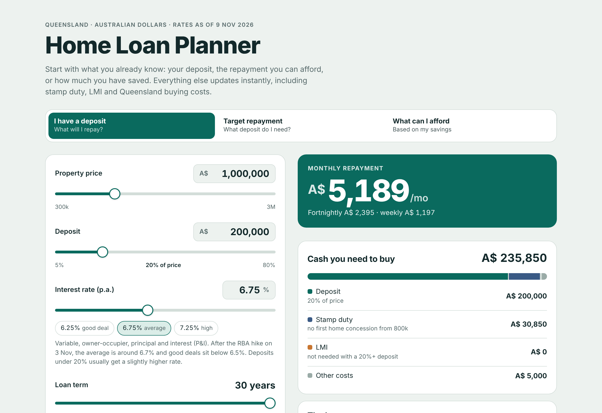
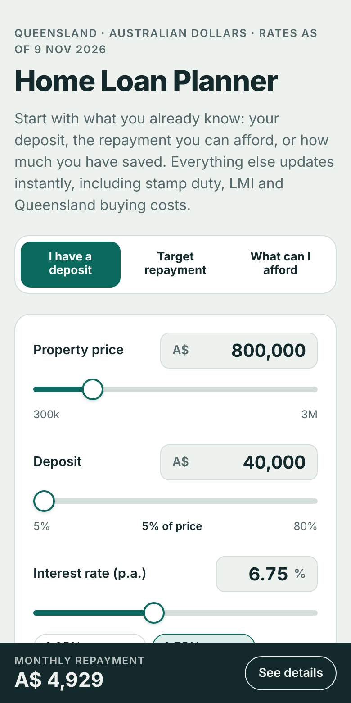
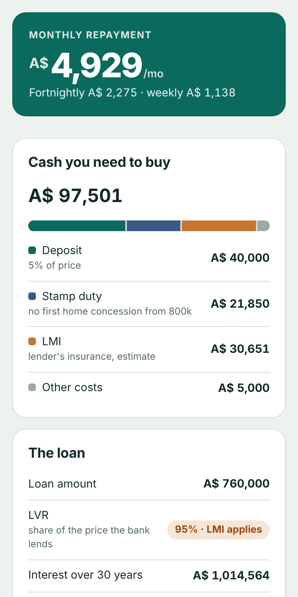
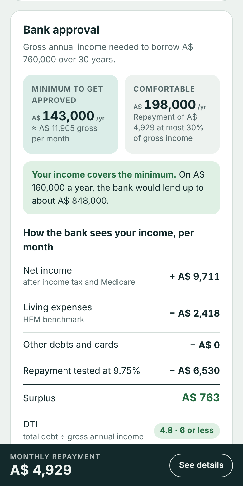

# QLD Home Loan Planner

**Plan your home purchase in Queensland in a few minutes.** 
Repayments, deposit, stamp duty, LMI and the income a bank wants to see, on one free page.

**[Open the planner →](https://dougfwnny.github.io/qld-home-loan-planner/)**

[How to use](#how-to-use) · [Example](#example) · [FAQ](#faq) · [Report a problem](https://github.com/dougfwnny/qld-home-loan-planner/issues/new)

 

<picture>
  <source media="(prefers-color-scheme: dark)" srcset="docs/screenshot-dark.png">
  
</picture>

## Why this exists

Most mortgage calculators stop at the monthly repayment. In Queensland you also need cash for stamp duty, often LMI, and legal and inspection costs, and the bank has to agree that your income is enough. This planner puts all of that on one page, so you can see the real cost of a home and the income it takes before you talk to a bank or broker.

It is a single HTML file. There is no sign-up, no tracking and nothing to install.

## What you can do

<table>
  <tr>
    <td align="center" width="33%" valign="top">
       
      <b>Start from what you know</b> 
      Your deposit, the repayment you want, or how much you have saved.
    </td>
    <td align="center" width="33%" valign="top">
       
      <b>See the full cost</b> 
      Repayment, stamp duty, LMI and other costs, added up for you.
    </td>
    <td align="center" width="33%" valign="top">
       
      <b>Check bank approval</b> 
      The income you need and how a lender assesses it.
    </td>
  </tr>
</table>

- **Three starting points:** work out the repayment from your deposit, the deposit from a target repayment, or the highest price your savings allow.
- **Queensland stamp duty:** standard rates, home concession, first home concession and the new first home exemption, plus 8% AFAD for foreign buyers.
- **LMI estimate** when your deposit is under 20%, and the **5% Deposit Scheme** that removes it for eligible first home buyers.
- **Bank approval:** the minimum and comfortable income for your loan, a step-by-step view of how lenders assess you, and a table of income by price and deposit.
- **Rate changes:** what you would pay if rates move, including the bank's stress test at your rate plus 3%.
- **Works anywhere:** phone or desktop, light or dark mode. Your inputs are remembered in your browser.

## How to use

1. **[Open the planner](https://dougfwnny.github.io/qld-home-loan-planner/).** It works in any modern browser.
2. **Pick what you know** using the tabs at the top:

   | Tab | You enter | You get |
   |---|---|---|
   | **I have a deposit** | Property price and deposit | Monthly, fortnightly and weekly repayment |
   | **Target repayment** | Property price and the repayment you want | The deposit you need |
   | **What can I afford** | Your savings and maximum repayment | The highest price that works |

3. **Set the interest rate and loan term.** Tap a preset (6.25%, 6.75% or 7.25%) or type your lender's rate.
4. **Open "QLD buying costs"** and tell it about your purchase: living in it or investing, first home or not, new or established, and whether you will use the 5% Deposit Scheme.
5. **Open "Income and expenses for approval"** and add who is borrowing, your children, income, living expenses, other loans and credit card limits. Income and expenses are optional, but they let the planner tell you whether your income is enough.
6. **Read the results** on the right (or below, on a phone):
   - **The big number:** your answer for the tab you chose.
   - **Cash you need to buy:** deposit plus every upfront cost.
   - **The loan:** loan amount, LVR, total interest and total paid.
   - **Bank approval:** the income you need and how the bank gets there.
   - **What if rates change?:** repayments at other rates.

Change any number and everything updates instantly.

## Example

A first home buyer on their own, no children, buying an established home on the Gold Coast:

| | |
|---|---|
| Property price | A$ 800,000 |
| Deposit | A$ 40,000 (5%) |
| Rate and term | 6.75% variable, 30 years |
| **Monthly repayment** | **A$ 4,929** |
| Stamp duty | A$ 21,850 |
| LMI (estimate) | A$ 30,651 |
| Other costs | A$ 5,000 |
| **Cash needed to buy** | **A$ 97,501** |
| **Minimum income to get approved** | **A$ 143,000 a year** |
| Comfortable income (repayment at 30% of income) | A$ 198,000 a year |

If the same buyer qualifies for the **5% Deposit Scheme**, LMI drops to A$ 0 and the cash needed falls to **A$ 66,850**.

## FAQ

<b>How accurate is it?</b>

 
Stamp duty follows the Queensland Revenue Office scales and matches its published examples. Repayments use the standard loan formula. LMI and bank approval are estimates: every insurer and lender uses its own tables and rules, so treat those figures as a range. A broker or lender can give you exact numbers.

<b>Is my data sent anywhere?</b>

 
No. Everything is calculated in your browser. Your inputs are stored only in that browser's local storage so they are still there next time. Clearing your browser data removes them.

<b>Why is the minimum income higher than I expected?</b>

 
Banks must check that you could still pay if rates rose by 3 percentage points. At 6.75% they test your repayment at 9.75%. They also use a minimum figure for living expenses (HEM) even if you spend less, and they count about 3.8% of your credit card limits each month, even if you owe nothing.

<b>Does it work for other states?</b>

 
Repayments and bank approval work anywhere in Australia. Stamp duty, the state duty added to LMI and the 5% Deposit Scheme price cap are set for Queensland. Pull requests that add other states are welcome.

<b>What do LVR, LMI, HEM, DTI and AFAD mean?</b>

 

| Term | Meaning |
|---|---|
| **LVR** | Loan-to-value ratio: the share of the price you borrow. A 5% deposit is a 95% LVR. |
| **LMI** | Lenders mortgage insurance. A one-off premium, usually charged when the LVR is above 80%. It protects the lender, not you. |
| **HEM** | Household Expenditure Measure. A benchmark of living costs that banks use as a minimum. |
| **DTI** | Debt-to-income: total debt divided by gross annual income. Few loans above 6 are approved. |
| **AFAD** | Additional foreign acquirer duty. An extra 8% Queensland duty for foreign buyers. |

## Assumptions

Figures used, checked on 9 November 2026

 

| Item | Value used | Source |
|---|---|---|
| Default interest rate | 6.75% p.a. variable, owner-occupier, P&I | Canstar estimate after the RBA raised the cash rate to 4.85% on 3 Nov 2026 |
| Stamp duty | QRO general, home concession and first home concession rates for contracts from 1 Aug 2026 | [Queensland Revenue Office](https://qro.qld.gov.au/duties/transfer-duty/concessions/homes/first-home/) |
| AFAD | 8% of the price | [Queensland Revenue Office](https://qro.qld.gov.au/duties/investors/afad/assessing/) |
| LMI | Average Helia/QBE rate by LVR, plus 9% QLD duty on the premium | Published premium tables |
| 5% Deposit Scheme cap | A$ 1,000,000 (Brisbane, Gold Coast, Sunshine Coast) | [Housing Australia](https://www.housingaustralia.gov.au/faqs-and-key-terms) |
| Serviceability buffer | Rate + 3 percentage points | APRA |
| Debt-to-income | 6 times gross income or less | APRA DTI limit |
| Income tax | 2026-27 resident rates plus 2% Medicare levy, no offsets | ATO rates |
| Living expenses | Higher of your figure and an approximate HEM benchmark | Published HEM estimates |
| Credit cards | 3.8% of the total limit per month | Lender guidelines |

Not included: First Home Owner Grant, FIRB fees, home insurance, council rates, body corporate fees and moving costs.

## Run it yourself

- **Use it offline:** download [`index.html`](index.html) and open it in your browser. Without internet it uses system fonts; everything else works.
- **Host your own copy:** fork this repository, then go to **Settings → Pages**, choose **Deploy from a branch**, pick **main** and **/ (root)**, and save.

## Contributing

Corrections, rate updates and new features are welcome. [Open an issue](https://github.com/dougfwnny/qld-home-loan-planner/issues/new) or send a pull request.

Where the numbers live in <code>index.html</code>

 

- `DEFAULTS`: default price, deposit, rate and term
- `dutyGeneral`, `dutyHome`, `firstHomeConcession`: Queensland stamp duty scales
- `LMI_PTS`: LMI premium by LVR
- `SCHEME_CAP`: 5% Deposit Scheme price cap
- `incomeTax`: income tax brackets and Medicare levy
- `HEM_T`, `HEM_KID3`: living expense benchmarks
- `testRate`: the serviceability buffer (rate + 3)
- `commitments`: the 3.8% credit card factor
- `minIncome`, `maxLoan`: the DTI limit of 6
- The rate hint and the "Rates as of" line in the page header

## Disclaimer

This tool gives general estimates for planning. It is not financial, tax or legal advice. Check your figures with the Queensland Revenue Office, your lender or a mortgage broker before you make a decision.

## License

[MIT](LICENSE). Free to use, copy and change.
